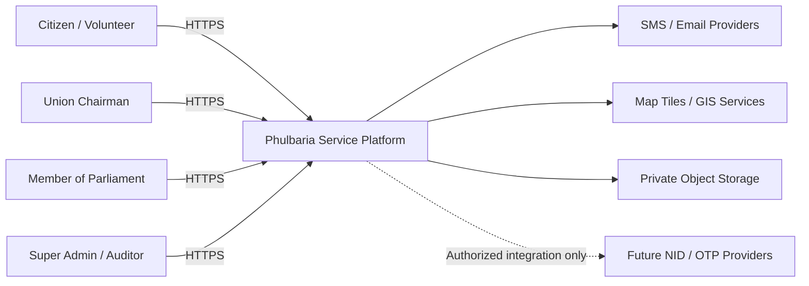
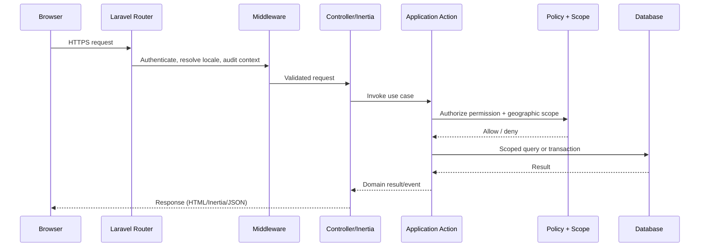

# Architecture

| Field | Value |
| --- | --- |
| Project | Phulbaria Upazila Service Platform |
| Pattern | Modular monolith |
| Backend | Laravel 13 / PHP 8.3+ |
| Frontend target | Vue 3 + TypeScript + Inertia.js + Tailwind CSS v4 |
| Data target | PostgreSQL 16+ with PostGIS 3.4+ |
| Administration target | Filament |
| Document status | Proposed architecture; Milestone 1 UI is Blade-based |
| Last updated | 4 November 2026 |

---

## 1. Architectural goals

1. **One deployable application.** A modular monolith keeps operational complexity low while the platform is being validated.
2. **Hard geographic boundaries.** Authorization is enforced in the backend and cannot be bypassed by manipulating URLs, forms, or APIs.
3. **Clear domain modules.** Citizen services, blood, volunteers, benefits, finance, reports, institutions, and GIS each have explicit boundaries.
4. **Bilingual and accessible delivery.** The presentation layer supports Bangla/English labels, mobile-first layouts, and progressive enhancement.
5. **Privacy and auditability by default.** Sensitive fields are isolated, access is logged, and data minimisation is designed into schemas.
6. **Incremental frontend migration.** Milestone 1 uses Blade + Tailwind. Inertia/Vue is introduced only when interactive workflows require it.

## 2. System context



The prototype does not call external services. Future integrations are shown as optional and require explicit approval.

## 3. Proposed technology stack

### 3.1 Installed in Milestone 1

| Component | Version / choice | Purpose |
| --- | --- | --- |
| PHP | 8.3.36 | Runtime |
| Laravel Framework | 13.39.0 | Application framework |
| Laravel Tinker | 3.x | Development REPL |
| Tailwind CSS | 4.x | Utility-first styling |
| Vite | 7.x | Asset bundling |
| PHPUnit | 12.x | Backend tests |
| Laravel Pint | 1.x | PHP code style |
| SQLite | Local default | Skeleton local database and test database |
| Blade | Bundled with Laravel | Server-rendered prototype views |

### 3.2 Proposed but not installed

The following dependencies are part of the target architecture but **are not installed in Milestone 1**. They must be introduced deliberately in Milestone 2 after compatibility review and with security scanning.

| Dependency | Proposed version | Purpose | Status |
| --- | --- | --- | --- |
| `inertiajs/inertia-laravel` | Compatible with Laravel 13 | Server-side Inertia adapter | Not installed |
| `@inertiajs/vue3` | v2.x | Vue 3 Inertia client | Not installed |
| `vue` | 3.x | Interactive UI components | Not installed |
| `typescript` | 5.x | Frontend type safety | Not installed |
| `@vitejs/plugin-vue` | Compatible with Vite 7 | Vue SFC compilation | Not installed |
| `spatie/laravel-permission` | Compatible with Laravel 13 | Role/permission primitives | Not installed |
| `filament/filament` | Compatible with Laravel 13 | Administration panel | Not installed |
| PostgreSQL | 16+ | Production database | Not installed/configured |
| PostGIS | 3.4+ | Spatial data and queries | Not installed/configured |
| Redis | 7+ (optional) | Cache, queues, sessions at scale | Not installed |
| Object storage | S3-compatible | Private documents and uploads | Not selected |

The default `.env` currently uses SQLite and database-backed cache, queue, and sessions. PostgreSQL/PostGIS replaces SQLite only when spatial and production-grade data work begins. SQLite remains suitable for fast tests.

## 4. Modular monolith decomposition

Modules are logical boundaries first, physical folders second. Each module owns its domain models, actions, policies, events, queries, and HTTP endpoints. Modules may call another module through a small public service interface, not by reaching into its internals.

| Module | Responsibilities | Key data |
| --- | --- | --- |
| Identity & Access | Accounts, sessions, OTP, NID verification status, roles, permissions, scopes, delegations | users, profiles, consents, role assignments |
| Geography | Administrative hierarchy, wards, boundaries, scope resolution | geographic units, boundaries |
| Citizens | Citizen profile, household linkage, preferences, correction requests | citizen profiles, households |
| Blood | Donor registry, eligibility, matching, emergency requests, responses | donors, requests, responses |
| Volunteers | Activist/volunteer registry, verification, assignments | volunteers, assignments |
| Benefits | Programme catalogue, applications, documents, decisions | programmes, applications, documents |
| Financial Assistance | Intake, assessment, approvals, disbursements | requests, assessments, approvals, disbursements |
| Public Reports | Problem reports, triage, assignments, resolution | reports, attachments, updates |
| Institutions | Education and health directory data | institutions, services, verification |
| Infrastructure & GIS | Roads, assets, spatial layers, map queries | assets, geometries, layers |
| Notifications | In-app, SMS, email templates and delivery state | notifications, delivery logs |
| Audit & Oversight | Append-only audit records, access logs, reports | audit events, exports |
| Administration | Filament resources, system settings, role management | settings, admin actions |
| Public Content | Landing page, service catalogue, notices, bilingual copy | content pages, announcements |

### 4.1 Proposed code layout

The current Laravel skeleton stays in place. Domain code will be added gradually using a module-oriented structure:

```text
app/
├── Http/
│   ├── Controllers/           # Existing entry point
│   ├── Middleware/            # Scope resolution, audit, security headers
│   └── Requests/              # Form request validation
├── Modules/
│   ├── Geography/
│   │   ├── Actions/
│   │   ├── Models/
│   │   ├── Policies/
│   │   ├── Queries/
│   │   └── Services/
│   ├── IdentityAccess/
│   ├── Blood/
│   ├── Volunteers/
│   ├── Benefits/
│   ├── FinancialAssistance/
│   ├── PublicReports/
│   ├── Institutions/
│   └── InfrastructureGis/
├── Policies/                  # Cross-module policies if needed
├── Providers/
└── Support/                   # Shared value objects, enums, helpers
```

Two alternative layouts were considered: Laravel's default layer-first (`app/Models`, `app/Services`) and fully separate packages. Layer-first is simple but blurs domain boundaries as the platform grows; separate packages add premature overhead. A module-first layout inside one Laravel app gives the best balance.

## 5. Request lifecycle



Authorization must occur inside the application/action layer, not only in middleware or the UI. Controllers never build unrestricted queries directly.

## 6. Geographic scoping strategy

### 6.1 Scope resolution

- Every user may have one or more **role assignments**.
- Each assignment references a `geographic_unit_id` and an effective date range.
- A request context resolves the actor's active assignments into a set of permitted geographic subtrees.
- Permissions are checked together with the scope: `can('report.resolve')` is insufficient without `withinScope($report->geographic_unit_id)`.
- A user with no active assignment has no operational scope, even if their role name looks privileged.

### 6.2 Enforcement layers

1. **Route middleware** rejects unauthenticated or obviously out-of-scope access.
2. **Form requests** validate that submitted geography IDs belong to the actor's permitted subtree.
3. **Policies** combine permission checks and record-level scope checks.
4. **Query scopes** apply geographic constraints before pagination, aggregation, or export.
5. **Database constraints and tests** catch missing application checks.

Defence in depth is required; repeating the scope check at multiple layers is intentional.

### 6.3 Chairman and MP boundaries

- Chairman scope is the union subtree. Municipality wards follow the same rule under the municipality unit.
- MP scope is the upazila, but the role is aggregate/read-only by default.
- Aggregation uses a minimum cell size. If a group contains fewer than the threshold (proposed 10), the value is suppressed or coarsened.
- Cross-union comparison is available only through a specifically granted aggregate permission, never through ordinary list endpoints.

## 7. Role and permission architecture

- Use `spatie/laravel-permission` for permission/role primitives where it fits.
- Add a custom `role_assignments` table for geographic scope, effective dates, delegator, and status. Do not overload the package's global role assignment for geography.
- Permission names follow `module.action` (for example `blood_request.triage`, `benefit_application.approve`).
- System roles are protected: Super Admin, Auditor, Citizen, and base public access.
- Custom roles can be created only inside the creator's scope and with a subset of the creator's permissions.
- The backend refuses:
  - granting a permission the actor does not hold;
  - assigning a role outside the actor's scope;
  - granting a scope broader than the actor's own;
  - self-escalation or editing one's own privileged assignment;
  - removing the last active Super Admin.
- All grants, revocations, and scope changes are audited with a reason.
- Cached permissions are invalidated on change; sessions may be revalidated for high-risk changes.

See [role-permission-matrix.md](role-permission-matrix.md).

## 8. Data architecture

### 8.1 Database

- **Production target:** PostgreSQL 16+ with PostGIS 3.4+.
- **Local milestone default:** SQLite for the Laravel skeleton and fast tests.
- **Spatial data:** geometry columns in EPSG:4326, GiST indexes, bounded queries, import provenance.
- **Identifiers:** internal bigint primary keys plus non-sequential public references (ULID/UUID) for citizen-facing tracking codes.
- **Sensitive fields:** NID encrypted at application level with a hash for matching; documents in private storage; financial details restricted.
- **Audit data:** append-only tables, database permissions that deny update/delete to the application role, periodic export to immutable storage in production.

See [database-design.md](database-design.md).

### 8.2 File storage

- Supporting documents, report photos, and resolution evidence are private by default.
- Files are served through short-lived signed URLs after an authorization check, never from a public directory.
- Uploads are validated by content, size, and extension; metadata is treated as untrusted.
- Malware scanning is required before production.

### 8.3 Caching and queues

- Database cache/queue are acceptable for the skeleton and local development.
- Redis is the proposed production cache/queue backend for rate limiting, sessions, and background jobs.
- Long-running work (SMS/email, exports, GIS imports, image processing) runs in queued jobs.
- Cache keys include the actor/scope dimension where data is not public.

## 9. Frontend architecture

### 9.1 Milestone 1 (current)

- Blade layouts and components, Tailwind CSS v4, minimal JavaScript from Vite.
- Public pages use a shared public shell; dashboard placeholders use a portal shell.
- Bilingual copy is embedded in templates; form controls are labelled and keyboard accessible.
- No authentication, API, session, or database interaction beyond the skeleton.

### 9.2 Target (Milestone 2+)

- Inertia.js connects Laravel controllers to Vue 3 pages.
- TypeScript strict mode for frontend code; shared types generated from API contracts where practical.
- Vue components are used for interactive workflows (cascading geography, application wizard, map, dashboards). Static/public pages may remain server-rendered.
- Filament provides an administrative back office for Super Admin and authorized staff. Filament resources must call the same authorization policies and scope queries as citizen-facing code.
- Tailwind design tokens are shared between Blade and Vue.
- A small API may be exposed only where a native app or external integration is approved; it uses the same domain actions and policies.

## 10. Cross-cutting concerns

| Concern | Approach |
| --- | --- |
| Localization | Laravel translation files for UI strings; bilingual content fields `name_bn`/`name_en`; Bangla-first public pages |
| Audit | Central audit service + model events for high-risk domains; redaction rules; correlation IDs |
| Notifications | Database notifications first; SMS/email via queued jobs with retry and delivery logs |
| Search | Start with database full-text/ILIKE; consider PostgreSQL `tsvector` and trigram indexes; never bypass scope |
| Exports | Queued jobs, explicit permission, purpose and expiry, watermarked/limited columns, audit |
| Observability | Structured logs, `/up` health check, metrics, failed-job alerts, audit dashboards |
| Configuration | Environment variables, `.env` excluded from version control, documented `.env.example` |
| Feature flags | Config-driven prototype labels and disabled modules; no hidden production features in the demo |
| Security headers | Middleware with CSP, HSTS, referrer policy, frame restrictions, nosniff |
| Rate limiting | Per-IP and per-account limits on login, OTP, reports, blood requests, file uploads |

## 11. Architecture decisions

| ID | Decision | Rationale | Consequences |
| --- | --- | --- | --- |
| ADR-001 | Modular monolith | Small team, uncertain scale, shared transactions and deployment simplicity | Discipline required to keep module boundaries clean; no independent scaling |
| ADR-002 | PostgreSQL + PostGIS | Reliable relational integrity plus real spatial queries | Operational complexity compared with SQLite; requires local provisioning |
| ADR-003 | Inertia + Vue + TypeScript | Rich forms and dashboards without a separate SPA API | Frontend build complexity; server-driven routing |
| ADR-004 | Filament for administration | Fast, consistent admin CRUD and authorization integration | Must be customized to respect geographic scopes and avoid exposing sensitive fields |
| ADR-005 | Blade prototype first | Validate layout, bilingual content, and accessibility before adding tooling | Some rework when Inertia pages replace Blade layouts |
| ADR-006 | Custom scoped role assignments | Geographic authority is a first-class requirement; package-global roles are insufficient | More domain code and tests; must protect against escalation |
| ADR-007 | Private-by-default files with signed access | Sensitive documents and report photos are high-risk | More storage/authorization work; no public CDN URLs for private files |
| ADR-008 | Synthetic demo data only | Prevents real NID/health/financial data exposure during prototyping | Less realistic demos; explicit data provenance required |

## 12. Milestone 1 implementation notes

- The prototype uses Blade, not Inertia/Vue. This is deliberate and documented so the UI can be reviewed before frontend tooling is installed.
- Routes are read-only GET pages. There are no POST authentication routes, no database writes, and no external calls.
- The login and registration forms are visually representative but their submit buttons are disabled with an explicit prototype explanation.
- The admin dashboard is a static placeholder; it does not expose real data or imply that authorization exists.
- Configuration names live in `config/platform.php`; no secrets are stored there.
- Any future installation of Inertia, Vue, TypeScript, Filament, PostgreSQL, or PostGIS must be recorded as a separate milestone change with lockfile updates and tests.

## 13. Known architectural risks

| Risk | Impact | Mitigation |
| --- | --- | --- |
| Scope enforcement is inconsistent across modules | Cross-union data exposure | Central scope service, policy tests, query review checklist |
| Filament bypasses domain policies | Privilege escalation/data leakage | Custom authorization in every Filament resource; integration tests |
| PostGIS complexity delays delivery | Milestone slippage | Start with simple point/line data and documented SRID; expand later |
| Bangla font size and rendering vary by device | Poor readability | Self-host fonts, test on Android/Windows, set line-height and fallback stack |
| Aggregate dashboards enable re-identification | Privacy harm | Minimum cell size, suppression, export controls, privacy review |
| External integrations are assumed | Legal/security exposure | No integration without written authorization and legal review |
| Prototype mistaken for official service | Public trust harm | Persistent disclaimers, no government marks, no production-looking claims |
