# Database Design

| Field | Value |
| --- | --- |
| Project | Phulbaria Upazila Service Platform |
| Design status | Proposed; no domain migrations implemented |
| Target database | PostgreSQL 16+ with PostGIS 3.4+ |
| Current local database | SQLite (Laravel skeleton) |
| Last updated | 4 November 2026 |

> Milestone 1 intentionally contains **no domain migrations and no demo business data**. The only schema present is Laravel's default users, password reset tokens, cache, jobs, and sessions tables. This document is the design baseline for Milestone 2 onwards.

---

## 1. Design principles

- **PostgreSQL first.** Production design uses PostgreSQL features (JSONB, constraints, partial indexes, PostGIS). SQLite is for fast tests and local bootstrapping only.
- **Explicit geography.** Every operational record carries or derives a `geographic_unit_id`; scope queries must not depend on free-text addresses.
- **Sensitive data isolation.** NID, health, family, and financial data live in restricted tables or encrypted columns, not in general-purpose profile tables.
- **Append-only history.** Decisions, status transitions, and audit events are recorded as immutable history rows.
- **Soft deletion with care.** Operational records may be archived, but audit and financial decision history must never be silently deleted.
- **Non-sequential public identifiers.** Citizen-facing tracking references use ULIDs/UUIDs while internal joins use bigint keys.
- **Data minimisation.** Optional fields are avoided unless a service requires them; no NID collection before an approved verification process.
- **Provenance for public data.** Institution, infrastructure, and GIS records include source, verification status, and last-verified date.

## 2. Conventions

| Topic | Convention |
| --- | --- |
| Tables | `snake_case`, plural |
| Primary keys | `id` bigint unsigned, identity |
| Public references | `public_id` ULID/UUID, unique, indexed |
| Foreign keys | `<entity>_id`, with explicit delete/restrict behaviour |
| Timestamps | `created_at`, `updated_at` (UTC) |
| Geography | `geographic_unit_id` referencing `geographic_units` |
| Money | `amount_minor` bigint + `currency` char(3), never floats |
| Enums | PostgreSQL enum or constrained string + application enum; prefer constrained strings for migration flexibility |
| JSON | `jsonb` with documented shape, never an excuse to avoid important tables |
| Spatial | `geometry(Point, 4326)`, `geometry(LineString, 4326)`, `geometry(MultiPolygon, 4326)`; GiST indexes |
| Soft deletes | `archived_at` or `deleted_at` where legally/operationally appropriate |
| Audit | Separate append-only schema/table; no update/delete grants for the application role |

## 3. Entity relationship overview

```mermaid
erDiagram
    GEOGRAPHIC_UNITS ||--o{ GEOGRAPHIC_UNITS : parent
    GEOGRAPHIC_UNITS ||--o{ CITIZEN_PROFILES : contains
    GEOGRAPHIC_UNITS ||--o{ ROLE_ASSIGNMENTS : scoped_to
    USERS ||--|| CITIZEN_PROFILES : has
    USERS ||--o{ ROLE_ASSIGNMENTS : receives
    ROLES ||--o{ ROLE_ASSIGNMENTS : assigned_as
    ROLES ||--o{ ROLE_PERMISSIONS : contains
    PERMISSIONS ||--o{ ROLE_PERMISSIONS : granted
    USERS ||--o{ CONSENTS : gives
    USERS ||--o{ BLOOD_DONORS : opts_in
    BLOOD_DONORS ||--o{ DONOR_RESPONSES : responds
    EMERGENCY_BLOOD_REQUESTS ||--o{ DONOR_RESPONSES : receives
    USERS ||--o{ VOLUNTEERS : applies
    VOLUNTEERS ||--o{ VOLUNTEER_ASSIGNMENTS : receives
    BENEFIT_PROGRAMS ||--o{ BENEFIT_APPLICATIONS : receives
    BENEFIT_APPLICATIONS ||--o{ APPLICATION_DOCUMENTS : includes
    BENEFIT_APPLICATIONS ||--o{ APPLICATION_STATUS_HISTORY : tracks
    USERS ||--o{ FINANCIAL_ASSISTANCE_REQUESTS : submits
    FINANCIAL_ASSISTANCE_REQUESTS ||--o{ FINANCIAL_ASSESSMENTS : assessed_by
    FINANCIAL_ASSISTANCE_REQUESTS ||--o{ FINANCIAL_APPROVALS : approved_by
    FINANCIAL_ASSISTANCE_REQUESTS ||--o{ DISBURSEMENTS : paid_by
    USERS ||--o{ PROBLEM_REPORTS : reports
    PROBLEM_REPORTS ||--o{ REPORT_ATTACHMENTS : has
    PROBLEM_REPORTS ||--o{ REPORT_UPDATES : tracks
    GEOGRAPHIC_UNITS ||--o{ INSTITUTIONS : contains
    GEOGRAPHIC_UNITS ||--o{ INFRASTRUCTURE_ASSETS : contains
    USERS ||--o{ AUDIT_EVENTS : acts
```

The diagram is conceptual. Join tables for roles, documents, and assignments are simplified.

## 4. Geography

### `geographic_units`

Single adjacency-list table for the administrative hierarchy. It avoids separate tables per level and supports arbitrary future levels.

| Column | Type | Notes |
| --- | --- | --- |
| `id` | bigint PK | Internal key |
| `public_id` | uuid/ulid unique | External reference |
| `parent_id` | bigint nullable FK self | Root is Bangladesh |
| `type` | varchar(24) | `country`, `division`, `district`, `upazila`, `union`, `municipality`, `ward` |
| `code` | varchar(32) unique | Authoritative BBS/administrative code if available |
| `name_bn` | varchar(160) | Bangla name |
| `name_en` | varchar(160) | English name |
| `short_name_bn` | varchar(80) nullable | Display name |
| `short_name_en` | varchar(80) nullable | Display name |
| `geom` | geometry(MultiPolygon,4326) nullable | Boundary, only when sourced |
| `centroid` | geometry(Point,4326) nullable | Approximate display point |
| `is_active` | boolean default true | Prevent selection of retired units |
| `verified_at` | timestamp nullable | Provenance |
| `source` | varchar(255) nullable | Dataset/source reference |
| `created_at`, `updated_at` | timestamps | |

Indexes: unique `code`, index `(parent_id, type, is_active)`, GiST on `geom` and `centroid`.

Seed data for the 13 unions and municipality is public administrative information. Ward boundaries and geometry are **not** to be invented; they require an authoritative source or explicit prototype provenance.

### `geographic_closures` (optional)

A closure table for fast descendant/ancestor queries. Can be generated and maintained by triggers or application jobs. Alternative: recursive CTEs. Choose one approach in Milestone 2 based on query plans.

## 5. Identity, access, and consent

### `users`

Start from the Laravel default and extend later:

| Column | Type | Notes |
| --- | --- | --- |
| `id`, `public_id` | bigint, uuid | Internal/public |
| `name` | varchar(160) | Display name |
| `mobile` | varchar(20) unique nullable | Primary login after verification |
| `email` | varchar(255) unique nullable | Optional; lower-cased |
| `password` | varchar(255) nullable | Nullable only for future NID/OTP-only flows if approved |
| `email_verified_at`, `mobile_verified_at` | timestamp nullable | Verification state |
| `preferred_locale` | varchar(5) default `bn` | `bn`/`en` |
| `status` | varchar(20) | `pending`, `active`, `suspended`, `closed` |
| `last_login_at` | timestamp nullable | Operational |
| `disabled_at` | timestamp nullable | Administrative |
| `created_at`, `updated_at` | timestamps | |

Do not store NID, blood group, income, or health fields here.

### `citizen_profiles`

| Column | Type | Notes |
| --- | --- | --- |
| `id`, `public_id` | bigint, uuid | |
| `user_id` | bigint unique FK | One profile per user |
| `full_name_bn`, `full_name_en` | varchar(160) | Names as provided |
| `date_of_birth` | date nullable | Minimise; derive age buckets where possible |
| `gender` | varchar(20) nullable | Optional, self-described values reviewed |
| `father_name`, `mother_name` | varchar(160) nullable | Family-sensitive; restrict |
| `spouse_name` | varchar(160) nullable | Family-sensitive; restrict |
| `primary_geographic_unit_id` | bigint FK | Ward-level residence |
| `address_line` | varchar(255) nullable | Minimise; avoid precise details unless required |
| `postcode` | varchar(10) nullable | Optional |
| `photo_path` | varchar(255) nullable | Private storage |
| `verification_status` | varchar(20) | `unverified`, `pending`, `verified`, `rejected` |
| `verified_at` | timestamp nullable | |
| `created_at`, `updated_at` | timestamps | |

### `nid_verifications` (future, restricted)

| Column | Type | Notes |
| --- | --- | --- |
| `id` | bigint PK | |
| `user_id` | bigint FK | |
| `nid_hash` | varchar(128) unique | HMAC/hash for duplicate detection |
| `nid_encrypted` | text | Application-level encryption |
| `nid_last4` | char(4) nullable | Masked display only if policy allows |
| `verification_provider` | varchar(80) | Approved provider/integration |
| `verification_status` | varchar(20) | |
| `verified_at` | timestamp nullable | |
| `metadata` | jsonb | No raw NID or documents |
| `created_at`, `updated_at` | timestamps | |

No real NID data may be inserted in prototype/demo environments. The table is not created in Milestone 1.

### `consents`

| Column | Type | Notes |
| --- | --- | --- |
| `id` | bigint PK | |
| `user_id` | bigint FK | |
| `consent_type` | varchar(80) | `privacy_notice`, `data_sharing`, `blood_contact`, `research` |
| `document_version` | varchar(32) | Version of the notice/terms |
| `granted_at` | timestamp | |
| `withdrawn_at` | timestamp nullable | |
| `ip_hash` | varchar(64) nullable | Hashed, not raw IP where possible |
| `evidence` | jsonb nullable | Minimal audit metadata |
| `created_at`, `updated_at` | timestamps | |

### `roles`, `permissions`, `role_permissions`

If using `spatie/laravel-permission`, follow its schema for base roles and permissions. Add:

- `roles.is_system` boolean to protect base roles;
- `roles.scope_level` enum (`global`, `upazila`, `union`, `ward`, `self`);
- `roles.description_bn`, `roles.description_en`;
- `permissions.module`, `permissions.risk_level`, descriptions in both languages.

### `role_assignments`

| Column | Type | Notes |
| --- | --- | --- |
| `id` | bigint PK | |
| `user_id` | bigint FK | |
| `role_id` | bigint FK | |
| `geographic_unit_id` | bigint nullable FK | Null only for global system roles |
| `assigned_by` | bigint FK users | |
| `starts_at`, `ends_at` | timestamps | Effective period; end optional |
| `status` | varchar(20) | `active`, `revoked`, `expired` |
| `reason` | text nullable | Required for high-risk roles |
| `revoked_at` | timestamp nullable | |
| `created_at`, `updated_at` | timestamps | |

Unique partial constraint: one active assignment of the same role to the same user at the same scope. Index `(user_id, status)`, `(geographic_unit_id, role_id)`.

### `delegations`

Optional explicit delegation record: delegator, delegate, permission, scope, starts/ends, reason, approval. Immutable after creation except revocation. This makes "cannot grant beyond own authority" auditable.

### `sessions`, `password_reset_tokens`, `otp_challenges`

Laravel defaults for sessions/password reset. `otp_challenges` (future): user/mobile hash, purpose, hashed code, attempts, expires_at, consumed_at, IP hash. Never store plaintext OTP.

## 6. Geographic scope for every module

Each operational table includes `geographic_unit_id` (usually ward/union) and, where useful, a denormalised `union_id` and `upazila_id` for fast scoping. Denormalised columns must be derived server-side and validated; never accept them from the client.

Scope queries use the actor's permitted unit IDs and descendant units. The application must filter before pagination and aggregation.

## 7. Blood

### `blood_donors`

| Column | Type | Notes |
| --- | --- | --- |
| `id`, `public_id` | bigint, uuid | |
| `user_id` | bigint unique FK | One donor profile per user |
| `geographic_unit_id` | bigint FK | Ward/union of availability |
| `blood_group` | varchar(3) | `A+`, `A-`, `B+`, `B-`, `AB+`, `AB-`, `O+`, `O-` |
| `last_donation_date` | date nullable | Eligibility interval |
| `is_available` | boolean default false | Opt-in, explicit |
| `public_visibility` | boolean default false | Name/area visible; contact never public |
| `contact_preference` | varchar(20) | `in_app`, `phone_relay`, `sms` |
| `eligibility_status` | varchar(20) | `eligible`, `temporarily_deferred`, `unknown` |
| `notes_private` | text nullable | Restricted; avoid health details |
| `consented_at` | timestamp | |
| `created_at`, `updated_at` | timestamps | |

Indexes: `(geographic_unit_id, blood_group, is_available)`, unique `user_id`.

### `emergency_blood_requests`

| Column | Type | Notes |
| --- | --- | --- |
| `id`, `public_id` | bigint, uuid | Public tracking reference |
| `requester_user_id` | bigint FK nullable | Null for staff-created requests |
| `patient_name` | varchar(160) | Minimise; restrict |
| `patient_age` | smallint nullable | Maybe age band instead |
| `blood_group` | varchar(3) | |
| `units_needed` | smallint | |
| `hospital_institution_id` | bigint nullable FK | |
| `hospital_name_free_text` | varchar(160) nullable | |
| `geographic_unit_id` | bigint FK | Location scope |
| `location` | geometry(Point,4326) nullable | Approximate |
| `needed_by` | timestamp | |
| `urgency` | varchar(20) | `critical`, `urgent`, `planned` |
| `status` | varchar(20) | `open`, `matching`, `fulfilled`, `expired`, `cancelled` |
| `contact_method` | varchar(20) | Relay recommended |
| `expires_at` | timestamp | |
| `created_at`, `updated_at` | timestamps | |

### `donor_responses`

`request_id`, `donor_id`, `status` (`offered`, `accepted`, `declined`, `fulfilled`, `withdrawn`, `expired`), `responded_at`, `notes_private`, `contact_shared_at`, unique `(request_id, donor_id)`. Contact sharing is logged.

## 8. Volunteers

### `volunteers`

`user_id` unique, `type` (`activist`, `volunteer`, `blood_coordinator`), `geographic_unit_id`, `skills` jsonb, `availability` varchar, `verification_status`, `verified_by`, `verified_at`, `verification_notes`, `status`, timestamps.

### `volunteer_assignments`

`volunteer_id`, `assignable_type`/`assignable_id` (programme, report, blood drive), `geographic_unit_id`, `assigned_by`, `status`, `starts_at`, `ends_at`, `completed_at`, `outcome_notes`, timestamps. Authorization checks the assignment and geographic scope.

### `volunteer_activity_logs`

Optional append-only activity summary; no sensitive citizen details. Keep separate from audit logs.

## 9. Benefits

- `benefit_programs`: `public_id`, bilingual name/description, `program_code`, `owner_geographic_unit_id`, `eligibility_summary_bn/en`, `required_documents` jsonb, `opens_at`, `closes_at`, `status`, `risk_level`, `created_by`, timestamps.
- `benefit_program_scopes`: programme-to-geographic-unit mapping for availability.
- `benefit_applications`: `public_id`, `program_id`, `applicant_user_id`, `geographic_unit_id`, `status`, `submitted_at`, `decided_at`, `decision_reason_public`, `assigned_reviewer_id`, `form_data` jsonb (validated against programme schema), `consent_version`, timestamps.
- `application_documents`: `application_id`, `document_type`, `path`, `original_name`, `mime`, `size`, `sha256`, `uploaded_by`, `scan_status`, timestamps.
- `application_status_history`: append-only status, changed_by, public_note, internal_note (restricted), created_at.
- `application_decisions`: decision, decided_by, decision_note, created_at. A separate decision table supports maker-checker and immutability.

Unique constraint on active application per programme/applicant where the programme disallows duplicates. Enforce with a partial unique index or application transaction plus database constraint.

## 10. Financial assistance

- `financial_assistance_requests`: `public_id`, `applicant_user_id`, `geographic_unit_id`, `category`, `amount_requested_minor`, `currency`, `reason_summary`, `status`, `submitted_at`, `withdrawn_at`, timestamps.
- `financial_assessments`: `request_id`, `assessor_user_id`, `recommended_amount_minor`, `assessment_note` (restricted), `created_at`; one current assessment per request or append-only versions.
- `financial_approvals`: `request_id`, `approver_user_id`, `decision`, `approved_amount_minor`, `threshold_level`, `reason`, `decided_at`; enforce approver ≠ assessor and threshold authority.
- `disbursements`: `request_id`, `approval_id`, `amount_minor`, `method`, `reference_no`, `disbursed_by`, `disbursed_at`, `evidence_path` (private), `status`.
- `financial_request_documents`: same private-file controls as applications.

All money is stored as integer minor units. Internal notes are never exposed to applicants. Financial tables should use restricted database roles and column encryption where the threat model requires it.

## 11. Public problem reporting

- `report_categories`: bilingual name, slug, responsible unit type, default assignee role, active flag.
- `problem_reports`: `public_id`, `reporter_user_id` nullable, `is_anonymous`, `category_id`, `description`, `geographic_unit_id`, `location` geometry(Point,4326) nullable, `address_text` nullable, `status`, `priority`, `assigned_to` nullable, `assigned_unit_id`, `resolved_at`, `closed_at`, `created_at`, `updated_at`.
- `report_attachments`: `report_id`, private path, mime, size, sha256, uploaded_by, metadata_stripped_at.
- `report_updates`: append-only `status`, `public_note`, `internal_note` (restricted), `created_by`, `created_at`.
- `report_assignments`: report, assignee, assigned_by, assigned_unit, active dates.
- `report_duplicates`: `report_id`, `duplicate_of_id`, link type.

Public map/feed responses expose only approximate location, category, status, and public notes.

## 12. Institutions, infrastructure, and GIS

### `institutions`

`public_id`, `type` (`school`, `college`, `madrasah`, `hospital`, `clinic`, `community_clinic`, `other`), bilingual name, `ownership` (`government`, `non_government`, `community`), `geographic_unit_id`, `address_text`, `location` geometry(Point,4326), `phone_public`, `services` jsonb, `operating_hours` jsonb, `verification_status`, `verified_at`, `source`, `created_by`, timestamps. Health facilities must not expose private patient data.

### `infrastructure_assets`

`public_id`, `type` (`road`, `bridge`, `culvert`, `drain`, `water_point`, `building`, `other`), bilingual name/description, `geographic_unit_id`, `responsible_authority`, `condition` (`good`, `fair`, `poor`, `critical`), `geometry` geometry(Geometry,4326), `length_m` numeric nullable, `last_inspected_at`, `verification_status`, `source`, timestamps. Use subtype-specific detail tables if road attributes grow.

### `gis_layers`

`key`, bilingual title/description, `geometry_type`, `srid`, `is_public`, `source`, `source_url`, `license`, `version`, `published_at`, `created_by`. Feature data can live in module-specific tables; avoid an unbounded generic feature dump unless needed.

### `gis_imports`

`layer_id`, `file_path`, `checksum`, `feature_count`, `status`, `errors` jsonb, `imported_by`, `imported_at`. Immutable provenance record.

Indexes: GiST on all geometry columns; B-tree on `geographic_unit_id`, `type`, `status`.

## 13. Audit, notifications, and shared tables

### `audit_events` (append-only)

| Column | Type | Notes |
| --- | --- | --- |
| `id` | bigint PK | |
| `event_id` | uuid unique | Correlation |
| `actor_user_id` | bigint nullable FK | Null for system |
| `actor_role_code` | varchar(80) nullable | Snapshot at time of action |
| `action` | varchar(120) | `role.assigned`, `finance.approved` |
| `subject_type`, `subject_id` | varchar, bigint/uuid | Target |
| `geographic_unit_id` | bigint nullable | Scope at time of action |
| `result` | varchar(20) | `allowed`, `denied`, `success`, `failure` |
| `reason` | text nullable | Required for high-risk actions |
| `before` | jsonb nullable | Redacted |
| `after` | jsonb nullable | Redacted |
| `ip_hash` | varchar(64) nullable | Avoid raw IP where possible |
| `user_agent` | varchar(255) nullable | Truncated |
| `request_id` | varchar(80) nullable | Trace |
| `created_at` | timestamp | No updates/deletes |

Database permissions: application role may INSERT/SELECT according to role; no UPDATE/DELETE. Retention and export policy documented in [security-requirements.md](security-requirements.md).

### `data_access_logs`

For high-risk reads (NID reveal, financial detail, bulk export): actor, subject, field group, purpose, authorization basis, timestamp. Separate from general application logs.

### `notifications`

Use Laravel's notifications table or a custom table with channel, template, status, sent_at, failed_reason. Notification payloads must not contain sensitive data.

### `documents` / `attachments`

Prefer per-domain tables with explicit authorization rather than one global polymorphic table, to avoid accidental disclosure. If a shared table is used, every access must resolve the parent and its policy.

### `settings`

Bilingual, typed configuration values excluding secrets. Secrets remain in environment/secret storage.

## 14. Sensitive data and retention

| Data | Protection | Retention proposal |
| --- | --- | --- |
| NID | Hash + encrypted value, role-restricted, no logs | Only while verification is legally required; delete/retain per policy |
| Health/blood eligibility | Restricted table, field-level access | Active donor + defined inactive period |
| Family details | Restricted profile fields | While service relationship exists; review periodically |
| Financial applications | Restricted tables, encrypted notes, maker-checker | Statutory/audit period, then archive |
| Supporting documents | Private storage, signed access, malware scan | Per programme/legal requirement |
| Problem report media | Private, metadata stripped | Until resolution + appeals period |
| Audit events | Append-only, restricted read | Minimum 1 year; longer if required |
| Sessions/OTP | Laravel/session store, hashed OTP | Short-lived, automatic expiry |
| Analytics | Aggregated, no PII | Defined aggregation window |

Retention values are proposals pending legal and operational review. Deletion must propagate to backups according to a documented backup-retention policy.

## 15. Demo and prototype data rules

1. No real NID numbers, names, phone numbers, addresses, or financial records.
2. Use reserved/synthetic identifiers clearly marked as demo; never use a value that could belong to a real person.
3. Do not use official logos, seals, or photographs of identifiable people.
4. Geographic public names may be used, but ward boundaries and institution records must be labelled unverified unless sourced.
5. Demo data seeding is disabled in production by environment checks.
6. Screenshots and test fixtures follow the same rules.

Proposed demo identity format: names prefixed `Demo`, mobile numbers in a clearly fake range reserved for documentation, and public references like `DEMO-NID-0001` that are not valid NID formats.

## 16. Migration plan

| Milestone | Migrations |
| --- | --- |
| M2 | `geographic_units`, `role_assignments`/scope tables, audit baseline, user extensions, consents, `citizen_profiles` |
| M3 | verification status, OTP challenges, consent versions, data access logs |
| M4 | blood donors/requests/responses, volunteers/assignments, notifications |
| M5 | benefit programmes/applications/documents/decisions, financial requests/assessments/approvals |
| M6 | report categories/reports/attachments/updates, institutions, infrastructure, GIS imports/disbursements |
| M7 | aggregate/materialised views, map layer metadata, performance indexes |
| M8 | retention jobs, archival tables, production index tuning |

Each migration must include a rollback path, be tested against PostgreSQL (not only SQLite), and avoid destructive changes without a backup/rollout plan. PostGIS-specific migrations are not exercised by the SQLite test suite; CI must include a PostgreSQL/PostGIS job.

## 17. Open database decisions

- Use adjacency list plus recursive CTE, or a closure table for geography?
- Store public reference as ULID (sortable) or UUIDv7?
- Field-level application encryption versus PostgreSQL TDE/pgcrypto for NID/financial notes?
- Single attachments table versus per-module tables (current preference: per-module)?
- Audit logs in the main database with restricted grants, or a separate append-only store?
- Materialised views versus cached aggregate tables for MP/Chairman dashboards?
- Whether municipality wards and union wards share the same `ward` type or need a `municipality_ward` distinction.
